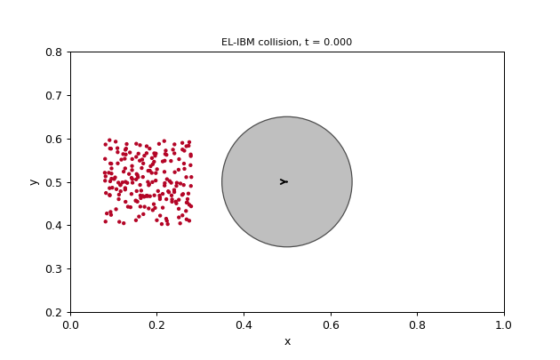
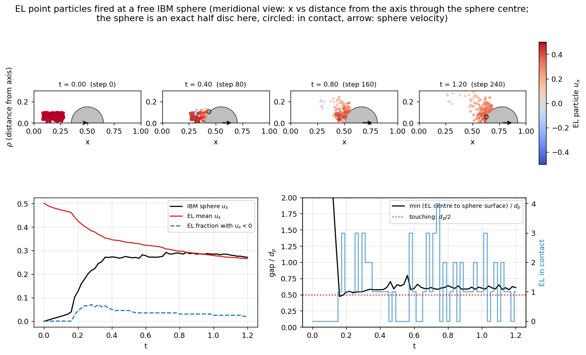
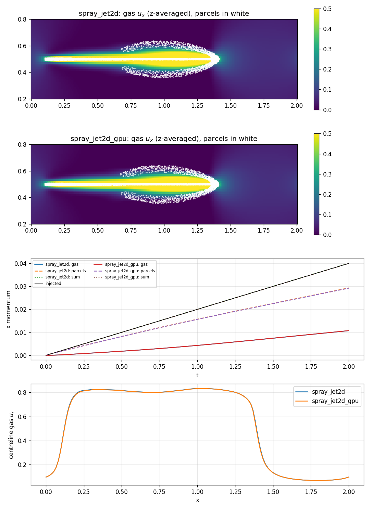
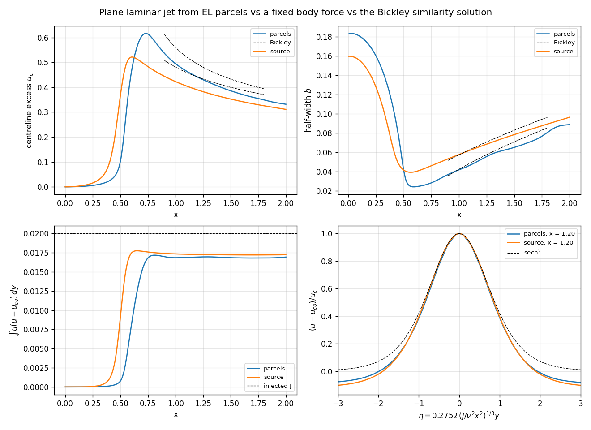
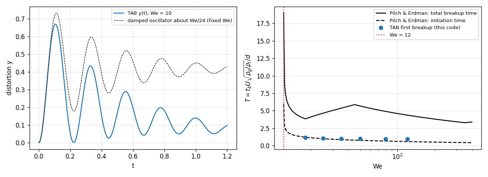
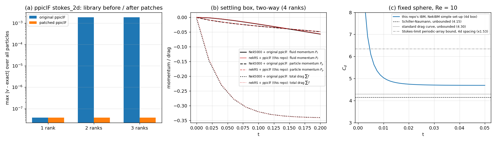
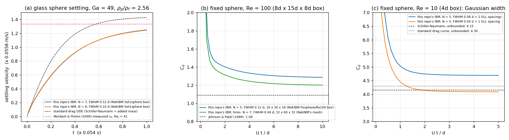
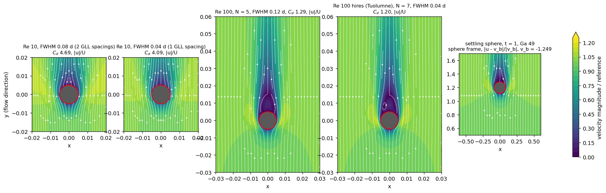

# NekRS-EL-IBM

Coupled Euler–Lagrange (EL) point particles and immersed-boundary (IBM) rigid
particles on top of [nekRS](https://github.com/Nek5000/nekRS), using
[ppiclF](https://github.com/dpzwick/ppiclF) for the Lagrangian side and
[NekIBM](https://github.com/YunchaoYang/NekIBM) as the reference for the IBM
direct forcing.



*Left: x–y projection, where particles above and below the sphere overlap its
outline. Right: x against the distance from the axis through the sphere
centre, where the sphere is an exact half disc; no particle enters it (closest
centre 0.47 d_p from the surface, touching at 0.5 d_p).*

- EL particles: drag, gravity, two-way momentum coupling (Gaussian projection,
  `F / (1 - phi_p)`), volume-filtered continuity
  `div u = -(1/phi_f) D phi_f/Dt`, soft-sphere EL–EL contact.
- IBM spheres: surface markers in ppiclF with explicit direct forcing, rigid
  6-DOF bodies in C++, soft-sphere EL–IBM contact.
- Two particle back ends. `src/elibm.hpp` runs ppiclF on the CPU (EL + IBM +
  contact, host-staged; nekRS's GPU backends should work unchanged but only
  the CPU backend has been tested). `src/elgpu.hpp` is a prototype that keeps
  EL particles on the device with nekRS's `lpm_t` and adds the projection and
  filter as OCCA kernels (EL + two-way + QTL, no contact or IBM yet); see
  [docs/design.md](docs/design.md) §4.

## Layout

| Path | What |
|---|---|
| `external/nekRS` | nekRS v26.0 (`96b3cf9e`), submodule |
| `external/ppiclF` | ppiclF `72483db` (last upstream commit), submodule |
| `external/NekIBM` | NekIBM `9631f97`, submodule; reference only, not built |
| `patches/ppiclF/` | fixes applied to ppiclF at build time (the submodule stays pristine) |
| `patches/nekRS/` | upstream fix for `lpm_t`'s RK3/RK4 stage state (for reference; not needed by this repo) |
| `src/elibm.hpp` | `elibm::Coupling`: EL + IBM coupling for a nekRS UDF (ppiclF, CPU) |
| `src/elgpu.hpp`, `src/elgpu.okl` | `elgpu::Coupling`: EL particles on the device with `lpm_t` (prototype) |
| `src/ppiclf_user_elibm.f`, `src/PPICLF_ELIBM.h`, `src/ELIBM.inc` | ppiclF user routines and particle layout for EL + IBM |
| `src/ppiclfCoupler.hpp`, `src/ppiclf_cbind.f` | low-level nekRS ↔ ppiclF helpers and C bindings |
| `scripts/build_ppiclf.sh` | builds a case-specific `libppiclF.a` and `udf.env` |
| `scripts/run_case.sh` | builds ppiclF for a case and runs it with nekRS |
| `scripts/plot_collision.py` | figures for the collision demo |
| `scripts/plot_validation.py` | figure for the validation against the originals |
| `scripts/plot_slices.py`, `src/fieldDump.hpp` | midplane contours of the IBM reference cases |
| `scripts/snapshots_to_vtk.py`, `scripts/paraview_collision.py` | particle snapshots → ParaView time series (.pvd), ParaView state for the collision case |
| `scripts/settling_reference.py` | NekIBM's reference cases (settling sphere, Re 100, Re 10 filter width) vs their references |
| `scripts/ppiclf_regression.py` | pristine vs patched ppiclF on ppiclF's own `stokes_2d` example |
| `cases/settling_twoway/nek5000_reference` | the settling box on Nek5000 v19 + unpatched ppiclF (reference for section 5 of the design doc) |
| `cases/` | verification cases and the collision demo |
| `docs/design.md` | model, numerics, ppiclF findings, verification, GPU roadmap |
| `docs/validation.md` | every verification/validation check (V1–V12): set-up, reference, commands, results, what each shows |

## Build and run

nekRS must be installed from `external/nekRS` (or the same commit) with double
`dfloat`. The UDF must be compiled with the same C++ compiler and standard
library as nekRS; with Open MPI wrappers set `OMPI_CXX` to the compiler nekRS
was built with (a libc++ UDF loaded into a libstdc++ nekRS segfaults in
`dlopen`).

```bash
git clone --recursive https://github.com/BCKim55/NekRS-EL-IBM.git
cd NekRS-EL-IBM
export NEKRS_HOME=$HOME/.local/nekrs
export OMPI_CXX=g++-16            # whatever built nekRS
# Cray EX (Tuolumne, Frontier): PrgEnv-gnu, FC=ftn CC=cc for the ppiclF build and
# LAUNCHER="flux run -g 1 -n" (or "srun -n"); see docs/design.md §6
scripts/run_case.sh cases/el_ibm_collision collision 4 --backend CPU
python3 scripts/plot_collision.py cases/el_ibm_collision
# ParaView: fluid checkpoints (collision.nek5000, enable the arrays in the reader; the projected
# particle volume fraction phi_p is written as scalar00, Config::phiCheckpointField), particles via
python3 scripts/snapshots_to_vtk.py cases/el_ibm_collision   # snapshots/el.pvd, body.pvd
```

`run_case.sh` rebuilds `libppiclF.a` only when the case's `user_routines`,
the shared model in `src/`, or the patches change, and always relinks the UDF.

## Cases

| Case | What it checks | Result |
|---|---|---|
| `rotation_tracer` | one-way: tracers in a frozen solid-body rotation | positions match ppiclF's discrete solution to 2e-14 on 1–8 ranks |
| `settling_twoway` | two-way: 10k particles settling in a periodic box, with `qtl` | projection error = Gaussian truncation (3.6e-4); momentum to 1e-3 of the gravity impulse; QTL imposed to nekRS's own divergence error; 1 and 4 ranks identical |
| `settling_gpu` | `settling_twoway` on the device path (`src/elgpu.hpp`) | matches the ppiclF path to 0.2–0.6 % in momenta and drag, same divergence error; 1 and 4 ranks identical; 8–10x faster per step even on CPU |
| `spray_jet2d`, `spray_jet2d_gpu` | spray step 1: parcels injected from a slot into quiescent gas, both paths on identical input | single droplet matches the drag ODE to 7e-8 of U0 on both; momentum budget closed to 1e-3; the two paths agree to 0.8 % in momenta, 0.7 % in centreline velocity |
| `jet_bickley` | plane laminar jet from a dilute fast parcel stream in an open domain vs the same momentum flux as a body force vs the Bickley similarity solution | momentum flux constant along the jet to 0.3 %, parcels 2.3 % below the body force; centreline decay within 3.5 % of Bickley, sech² profile; insensitive to filter width (0.04 → 0.06) and parcel count (10 → 40 per step) |
| `tab_breakup` | TAB deformation/breakup on single droplets at We 10–300 | oscillation period within 0.5 % of analytic; no breakup below We 12; breakup time on the Pilch & Erdman initiation curve (1.17 vs 1.21 at We 18) |
| `jet_modarress` | Modarress (1984) round particle-laden jet, Re 13 300 — set up for a GPU node | coarse-mesh smoke test only (full mesh does not link on macOS arm64) |
| `ibm_fixed_sphere` | NekIBM's `IBM_test/simple`: fixed sphere at Re 10 in a 4d periodic box, on this repo's IBM | C_d 4.69 vs 4.15–4.3 unbounded (the excess is the 4d-box blockage); lateral force 1e-10 |
| `ibm_sphere_re100`, `ibm_settling_sphere` (+ `_fine`) | NekIBM's own reference cases on this IBM: fixed sphere Re 100 (Johnson & Patel 1.09) and the Mordant & Pinton settling glass sphere (Ga 49, Re_t 41) | C_d 1.29 (+18 %, diffuse interface at d/10) on the laptop grid, 1.20 (+10 %) on NekIBM's mesh (`hires`, Tuolumne, 8 MI300A); u_t 6 % slow on the laptop grid, 2.5 % slow on NekIBM's mesh (`hires`, Tuolumne, 16 MI300A, t = 1.2); see design doc §5d, §6 |
| `ibm_sphere_moving` | prescribed-motion sphere through fluid at rest (Pilobolus step 2) | C_d 1.26 ± 0.03 vs 1.29 for the fixed sphere in a stream on the same grid; ±2 % grid-crossing oscillation |
| `ibm_sphere_re300` | fixed sphere Re 300 on the hires mesh (prepared; Tuolumne) | Johnson & Patel C_d 0.656, St 0.137 |
| `el_ibm_adhesion` | the collision case with sticking contact (Pilobolus step 5) | 107/200 captured, none inside or bounced, momentum budget −3.2e-3 as without attachment |
| `pilobolus_launch` (+ `hires`, `sap`) | Pilobolus sporangium driven by the measured v(t) through air; fluid force, dry free-flight deceleration, sap droplets that stick (design doc §7) | air alone gives 111 m/s² (prescribed) / 125 m/s² (free flight) of the measured 1300; with sap 775/1011 droplets stick (90 % of the sporangium's mass), drag −36 %, loaded deceleration ~40 m/s²: the tail tension must do the rest (hires on Tuolumne pending) |
| `el_ibm_collision` | EL particles fired at a free IBM sphere | no particle enters the sphere, the sphere picks up the cloud's momentum (u 0 → 0.27), total momentum within 0.3 %, IBM slip ≈ 2 % of the body speed |









Every verification and validation check, with set-up, reference, commands, numbers and what each result does and does not show, is collected in [docs/validation.md](docs/validation.md) (V1–V12). Against the original codes (design doc §5): ppiclF before/after the patches, nekRS+ppiclF vs Nek5000+ppiclF, and the IBM sphere drag:



NekIBM's own reference cases (Mordant & Pinton settling sphere, Johnson & Patel Re 100 on the laptop grid and on NekIBM's mesh on Tuolumne, filter-width bracket at Re 10) on this IBM, design doc §5d:





## Status

- [x] ppiclF linked into a nekRS UDF (host-staged; ppiclF runs on CPU)
- [x] One-way and two-way momentum coupling
- [x] Volume-fraction (QTL) divergence
- [x] IBM rigid spheres (NekIBM-style direct forcing) on ppiclF markers
- [x] EL–EL and EL–IBM soft-sphere contact
- [x] Device EL path (`lpm_t` + projection/filter kernels), two-way + QTL
- [x] Spray step 1: parcels (`N_p` droplets each) and run-time injection, both paths
- [x] Spray step 2–3 (device path): TAB deformation drag and breakup, validated on single droplets
- [x] Validated against the originals (design doc §5): patched ppiclF exact on ppiclF's `stokes_2d` where the pristine one loses a particle on 2+ ranks; nekRS+ppiclF settling within 1 % of Nek5000+ppiclF; IBM sphere drag within blockage of standard drag (NekIBM itself does not run on macOS/gfortran)
- [x] Separate EL and IBM filter widths (ppiclF patch 0006, `Config::filterWidthIbm`), prescribed-motion bodies (`Body::prescribed`); Pilobolus launch case prepared (design doc §7)
- [x] Sticking contact / attached mass (`Config::attachOnContact`, `el_ibm_adhesion`), sap injection case
- [x] Pilobolus laptop runs: prescribed, free flight, sap (design doc §7.4–7.5)
- [ ] Pilobolus: Re 300 check and hires launch on Tuolumne; tether (tail tension) model
- [ ] KH-RT breakup, dense-regime drag, implicit drag for post-breakup droplets, spray-data validation
- [ ] IBM–IBM contact, particle–wall contact (ppiclF walls are not wired yet)
- [ ] Device path: contact (cell list), IBM markers, implicit Helmholtz filter

## License

BSD 3-Clause, see [LICENSE](LICENSE). The submodules keep their own licenses
(nekRS and NekIBM: UChicago Argonne BSD-style; ppiclF: MIT). The patches in
`patches/ppiclF/` modify ppiclF source and remain under ppiclF's MIT license,
[patches/ppiclF/LICENSE.ppiclF](patches/ppiclF/LICENSE.ppiclF).
